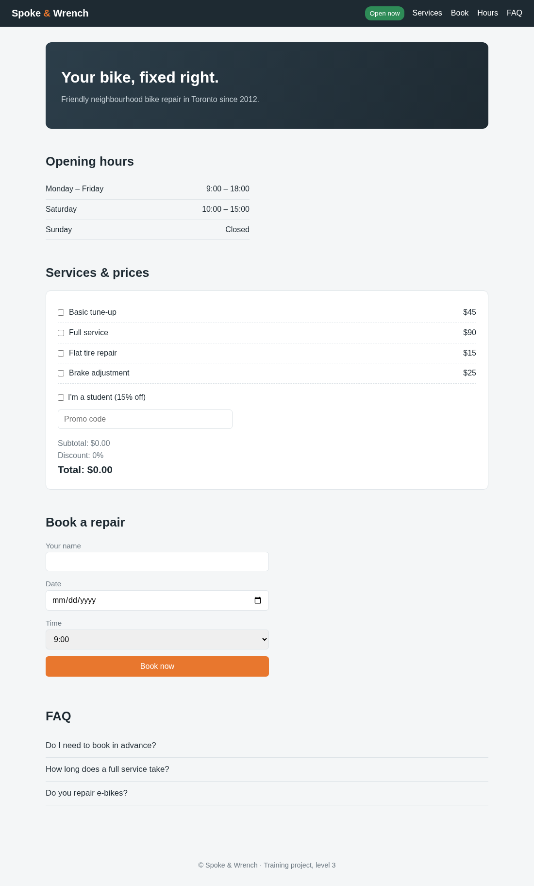
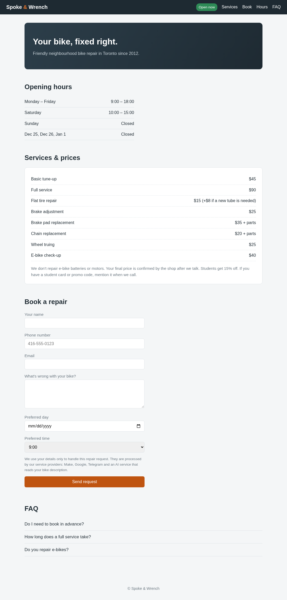
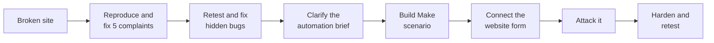

# Spoke & Wrench: from broken website to tested booking automation

An end-to-end case study of a small-business job: diagnose a broken website from vague client complaints, fix it, connect it to an AI-assisted booking workflow, attack the result, and harden it.

> **Training project.** Spoke & Wrench, its owner "Mike" and the job prices are part of a simulated client exercise. Nothing here was deployed for a real business, and all test data is synthetic. The work was done with [Claude Code](https://claude.com/product/claude-code) as an AI coding agent, while I directed scope, client decisions and review. See [Tools](docs/05-tools.md).

| Before | After |
|---|---|
|  |  |

## The result

| Area | Before | After |
|---|---|---|
| **Booking days** | Mondays refused, Sundays accepted | Correct in Toronto time, with holidays blocked |
| **Open/closed badge** | "Open" after closing time | Follows real hours from any time zone |
| **Discounts** | Stacked to 25%, lowercase code failed | Public calculator removed to prevent price disputes |
| **Navigation and FAQ** | Menu vanished, 2 of 3 answers dead | Both work, with screen-reader state |
| **Booking handling** | About an hour of manual copying each evening | Sheet row, Telegram alert, AI estimate and customer email |
| **Security** | HTML injection in the name field | Strict CSP, server-side validation, email rate limits |

The included test suite runs the same checks on both versions:

```text
Broken page reproduced 12/12 bugs. Final page passed 17/17 checks.
```

## The path, step by step



| Step | What happened | Read more | Git tag |
|---|---|---|---|
| 0. Intake | Received a broken page and five vague complaints | [Brief and plan](docs/01-brief-and-plan.md) | `stage-0-broken` |
| 1. Bug fixes | Found the root cause of each complaint | [Debugging](docs/02-debugging.md) | `stage-1-reported-bugs` |
| 2. Retest | Fixed holidays, invalid times, layout and accessibility issues | [Debugging](docs/02-debugging.md#round-2-bugs-nobody-reported) | `stage-2-polished` |
| 3. Automation | Built the form-to-Sheet, Telegram, AI and email workflow | [Automation](docs/03-automation.md) | `stage-3-form-connected` |
| 4. Hardening | Tested abuse cases, then fixed what broke | [Security and testing](docs/04-security-and-testing.md) | `stage-4-hardened` |
| 5. Review | Recorded tools, trade-offs and remaining limits | [Tools](docs/05-tools.md), [Limits and lessons](docs/06-limits-and-lessons.md) | `v1.0` |

## Explore the history

Each fix is its own commit, so the history can be read like a work log:

```bash
git log --oneline --reverse                           # every step in order
git diff stage-0-broken stage-1-reported-bugs -- site # the core bug fixes
git show stage-3-form-connected:site/index.html > /tmp/stage-3.html
```

## Run it

You need Node.js 20+ and Chromium or Chrome.

```bash
npm ci
npm test
# If your browser is elsewhere:
CHROME_PATH=/path/to/chrome npm test
```

The tests simulate the clock and time zone and mock the webhook, so they send no data anywhere. Open `before/index.html` and `site/index.html` directly in a browser to compare them. The final form shows a send error until you connect your own webhook, as described in the [automation setup](automation/README.md).

## Repository layout

```text
before/index.html    the site exactly as received, never edited
site/index.html      the finished site
automation/          sanitized Make scenario and setup guide
tests/               before/after regression suite and screenshots
scripts/             webhook and CSP setup helper
docs/                the full walkthrough
```

## Known limits

This is a tested prototype and was never launched. It has no CAPTCHA, so someone using many email addresses could still fill the sheet with fake requests. The full list and what I would do next are in [Limits and lessons](docs/06-limits-and-lessons.md).
