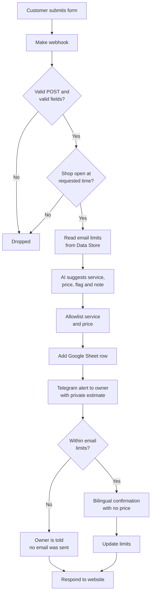

# 3. Building the automation

The workflow is a 26-module [Make](https://www.make.com/) scenario, counting its error handlers. The sanitized export is in [`automation/make-blueprint.sanitized.json`](../automation/make-blueprint.sanitized.json).

## How a request flows

## What each stage does

| Stage | Make module | Why it exists |
|---|---|---|
| Receive | Custom webhook | Gives the static site somewhere to send data |
| Validate | Filter and Set Variables | Browser checks can be bypassed, so the server repeats them |
| Rate-limit | Data Store | One email per address per hour, 60 per day |
| Triage | AI Tools: Extract | Turns free text into structured fields |
| Verify AI output | Switch modules | Only approved services and price formats get through |
| Record | Google Sheets | Keeps Mike's existing eight columns |
| Notify | Telegram | Puts the request and estimate on his phone |
| Confirm | Gmail | English and French acknowledgement |
| Respond | Webhook response | Tells the form whether to show success or retry |

## Designing the AI step

The model does a narrow job: classify a message against a fixed price list. Its full prompt is in the blueprint. Four decisions matter:

1. **It cannot invent prices.** It selects from Mike's list, and later modules reject anything outside the allowed patterns. An unknown service falls back to "Needs diagnosis", and an unknown price to "TBD".
2. **Customers never see its output.** The confirmation email is fixed text. A wrong guess can only reach Mike, who checks it before calling.
3. **Customer text is treated as data.** It sits inside `<customer_message>` tags with an instruction never to follow what it says.
4. **Uncertainty is visible.** Each result is flagged `OK`, `CALL` or `OUT OF SCOPE`.

Rule order matters too, so safety comes first. A cracked frame must produce a "do not ride" warning even if the message also mentions a service on the list.

## Testing with real examples

Mike's old messages became the first test set:

| Customer message | Suggested service | Estimate | Flag |
|---|---|---|---|
| "my back tire is flat again, third time this month" | Flat tire repair | $15 (+$8 if new tube) | OK |
| "Bonjour, mes freins ne fonctionnent presque plus et la chaîne saute" | Brake adjustment + Chain replacement | $45 + parts | CALL |
| "Haven't ridden since last summer, want it ready for the season" | Basic tune-up | $45 | CALL |
| "The battery on my e-bike dies after 5 km" | Not offered: e-bike battery/motor | N/A | OUT OF SCOPE |
| "something is making a clicking noise idk" | Needs diagnosis | TBD | CALL |
| "Can you fix my electric scooter? Its wheel is wobbly" | Not offered: not a bicycle | N/A | OUT OF SCOPE |

The first prompt added up the French request incorrectly and missed the tune-up. I tightened the rules and reran all six.

## Connecting the website

The form originally collected only a name, date and time. It now:

- Requires phone, email and a problem description.
- Says "Preferred day" and "Send request" instead of implying a confirmed booking.
- Tells customers Mike will call, and that the time **isn't booked until then**.
- Keeps their answers if sending fails, so they can retry.
- Includes a hidden honeypot field to catch simple bots.

## Running cost

Each booking uses about 11.4 Make credits. At 150–300 bookings a month, that is roughly 1,700–3,400 credits, so a live version would need a paid Make plan.

Next: [Security and testing](04-security-and-testing.md)
